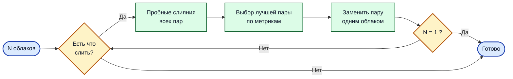

## Инструкции по запуску пайплана по регистрации набора облаков точек.

Мне не удалось заставить работать teaserpp_python. Он вылетал на моменте вызова _solver.getSolution()_. Поэтому исходники исполняемого файла написаны на C++, а сам исполняемый файл вызывается через Python c необходимой чтением-записью облаков в _tempfile.TemporaryDirectory()_.

### Компиляция исполняемого файла для регистрации пары облаков.
Необходимо установить библиотеки: [TEASER-plusplus](https://github.com/MIT-SPARK/TEASER-plusplus) и [PCL](https://github.com/PointCloudLibrary/pcl)


Перейдите в каталог `teaser_register` и выполните сборку:

```bash
cd ./teaser_register
mkdir build && cd build
cmake .. && make
```

После успешной сборки исполняемый файл `teaser_register` будет находиться в `teaser_register/build`.

Сам пайплайн регистрации следующий:



Решение о слиянии двух облаков принимает небольшая предобученная MLP-сеть

### Нейросетевой скоринг слияния (MLP)

Решение о том, можно ли слить два облака, принимает компактная полносвязная
нейронная сеть (MLP). Она обучена на открытых датасетax c лидаром MID360: [dataset1](https://zenodo.org/records/14841855), [dataset2](https://drive.google.com/file/d/1sF2Z5VT8W_Ywhjwg7PR3yG3tT2m5vLWY/view); как бинарный классификатор:
`1` — пару можно слить, `0` — нельзя.

**Архитектура** (`SimpleMLP`): `6 → 25 → 10 → 1`

- 3 полносвязных слоя, между первыми двумя — `ReLU` + `Dropout(0.1)`.
- Выход — логит; вероятность получается через `sigmoid`.


**Вход** — 6 метрик, вычисленных после пробной регистрации пары через TEASER++:

**Чекпоинт:** `checkpoints/final.pt` (обучен на 100% данных, `EPOCHS_FINAL` = средний
`best_epoch` из 5-fold CV). Загрузка — `load_final()`, инференс — `predict_final(features)`.
Порог слияния по умолчанию — `merge_prob_threshold = 0.5`.

| Признак | Диапазон | Что измеряет |
|---|---|---|
| `icp_fitness_fwd` | `[0, 1]` | Доля точек выровненного source-облака, у которых в target-облаке нашёлся сосед в радиусе 0.5 м (`evaluate_registration`, направление fwd). |
| `icp_fitness_bwd` | `[0, 1]` | То же, но в обратном направлении (target → source). Симметричен fwd, но не идентичен: разные плотности и перекрытия. |
| `normal_score` | `[0, 1]` | Согласованность нормалей поверхностей в точках-соответствиях. Усреднённая косинусная близость нормалей source и target. |
| `normal_mean_angle_deg` | `[0, 180]°` | Средний угол между нормалями в соответствующих точках. Дополняет `normal_score`, но в градусах — удобно для порогов. |
| `fsv_rate_fwd` | `[0, 1]` | Доля поз траектории `i`, перенесённой в фрейм `j`, в которых луч из камеры упирается в занятое пространство (free-space violation). По сути — «сколько поз противоречат геометрии target-облака». |
| `fsv_rate_bwd` | `[0, 1]` | То же для траектории `j` относительно облака `i` после обратного преобразования. |

Метрика качества слияния для сортировки и поиска наилудшей из возможных берется из выхода нейронной сети.

От вас требуется конфиг-файл с настройками алгоритма(рекомендуется оставить, как в примере) и путями к облакам точек `cloud_paths` и траекториям в них `traj_paths`. Пример: `./configs/hangar.yaml`.

Запуск пайплайна:
```bash
python ./code/clouds_registration.py --config ./configs/hangar.yaml
```
